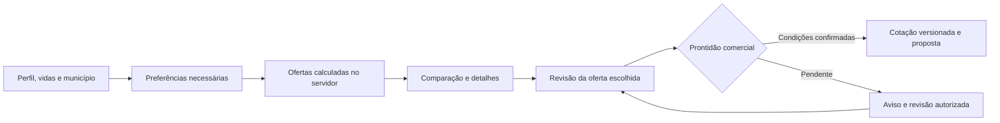

# Cotador real do Corretor Lite

Data: 2026-11-11. Estado: **piloto operacional implementado e restrito a Vinicios; plano amplo Q0–Q7 ainda parcial**.

Objetivo: transformar o cotador demonstrativo em uma ferramenta de trabalho com catálogo real, cálculo explicável, elegibilidade, rede, comparação e proposta versionada. Preservar a experiência Conversa/Arc do corretor, revelando informações no momento da decisão.

Decisão confirmada pelo Vinicios nesta sessão: **produto com preço vigente e condição comercial pendente aparece com aviso, mas não gera proposta final até revisão**. Registrada em DEC-178 e BR-098. As demais escolhas novas neste documento são propostas de implementação, não decisões de negócio implicitamente aprovadas.

## 1. Resultado para o corretor

Na mesma rota `/cotacao`, o corretor informa quem precisa do plano e onde ele será contratado, encontra ofertas com preço real, entende as condições de aceitação e verifica a rede antes de comparar. Escolhe uma oferta, revisa o valor por pessoa e as pendências e, quando estiver liberada, gera uma cotação histórica vinculada ao atendimento.

O caminho inicial continua conversacional. A saída **Ajustar detalhes** abre `/cotacao?completo=1` com os mesmos dados e resultados, para consultas densas, rede e comparação. Não haverá dois motores, duas bases de preços ou dois formulários com regras diferentes.

Critérios centrais: nenhum preço fictício no fluxo real; nenhum preço enviado pelo navegador como autoridade; nenhum campo extraído perdido na importação; nenhuma pendência tratada como confirmação; nenhum novo padrão visual local quando existir componente compartilhado.

## 2. Diagnóstico do código atual

Inspeção estática do checkout atual, sem afirmar que isso descreve um deploy já atualizado.

| Área | Evidência no código | Consequência para o plano |
|---|---|---|
| Entrada | `src/app/(dashboard)/cotacao/page.tsx` abre `QuoteChat` no Lite e `LightQuoteSimulator` com `?completo=1` | Evoluir a rota existente e conectar os dois modos ao mesmo caso de uso |
| Disponibilidade | `quote-availability.ts` usa pausa global constante e exceção por IDs fixos | Substituir a liberação por configuração administrativa e piloto escopado; não remover a pausa antes do aceite |
| Dados | `quote-flow.ts` e `use-quote-simulator.ts` usam `MOCK_PLANS`; resumo usa `MOCK_LEADS` | Retirar essas dependências do caminho real; fixtures permanecem só em testes/demonstração explicitamente isolada |
| Cálculo | `quote-simulator/pricing.ts` usa multiplicadores de região, acomodação, coparticipação e perfil, além de odontologia fixa | Substituir pelo preço da linha de tabela versionada; essas fórmulas não podem ser fallback comercial |
| Desconto | Hook e resumo aplicam desconto demonstrativo de 5% em PME | Remover do motor real; campanha depende de regra e fonte aprovadas |
| Perfil | Individual, Familiar, PME e Adesão; entidade e administradora aparecem confladas; PME tem limite demo 2–29 | Separar modalidade, composição familiar, administradora e entidade; limites dependem da regra do produto e do limite técnico configurado |
| Rede | Nomes fictícios de hospitais e contagem por presença em array local | Consultar IDs reais, versão, localização e vínculo do prestador ao plano |
| Catálogo | `global-catalog` e schema já possuem operadoras/planos, tabelas, versões, linhas e extensão privada | Ampliar esse domínio segundo DEC-031/ADR-0031; não criar um catálogo concorrente |
| Visibilidade | Em `listAvailableCatalogPlans`, o ramo de filial recalcula a lista a partir de `globalRows`, depois de aplicar ocultações do tenant | Dependência de Q0: garantir interseção das restrições, preservando a ocultação superior; criar regressão antes do rollout |
| Gravação | `createQuoteAction` valida plano disponível, mas aceita valores positivos do cliente e grava snapshot com nome | Para o caminho real, receber referência de resultado/oferta e recalcular no servidor; salvar versão, critérios e decomposição |
| Alternativas | A ação atual soma valores de todos os itens/line items em `totalMonthly` | Separar total de cada alternativa e total da oferta escolhida; comparação não pode somar mensalidades de planos concorrentes |
| Compartilhamento | `getQuoteByToken` consulta por token sem filtro de prontidão comercial | Aplicar DEC-178 também em query pública, PDF e ações; um token existente não libera proposta pendente |
| Linguagem visual | Chat e componentes Arc, escopo `.arc-venancor`, tokens e navegação Lite | Preservar a identidade em código; o estilo genérico Dub/Diretor não substitui o Conversa do corretor |

Esses pontos são dependências e riscos identificados, não correções entregues nesta tarefa. A importação de PDFs/conhecimento em `operator-catalog` tem outra finalidade: não será autoridade para um modelo de IA inventar preço ou aprovar elegibilidade.

## 3. Base de dados disponível e limites

Fonte local protegida: `C:/Users/kyper/.codex/outputs/cotadorfm-2026-11-11/`.
Relatórios: `REPORT.md`, `SIMULATIONS.md`, `API.md`, `COVERAGE.json` e os manifestos por conjunto.

| Conjunto conhecido no snapshot | Volume | Destino inicial |
|---|---:|---|
| Planos ativos do cotador de origem | 4.922 | Staging de catálogo, com 52 campos principais preservados |
| Preços relacionados | 61.952 | Histórico e versões comerciais; 51.364 ativos e 10.588 inativos na origem |
| Faixas etárias por ID | 31 | Preservar IDs e rótulos; correspondem a dez intervalos numéricos |
| Detalhes contratuais | 61.741 | Conteúdo e regras com 18 campos e 339 tipos de detalhe |
| Vínculos plano–unidade | 2.228.042 | Associação versionada, processada em lotes |
| IDs de unidade / conteúdos contextuais | 7.483 / 62.624 | Cadastro e versão integral contextual; hash não significa versão cronológica |
| Catálogo ativo de seleção de prestadores | 7.472 | Preservar como outra origem, sem fusão por nome |
| Municípios de comercialização por plano | 136.332 vínculos | Elegibilidade territorial com fonte |
| Perfis CNPJ por plano | 4.257 vínculos | Critérios empresariais com estado de confirmação |
| Referências de material / URLs / logos | 362 / 22 / 52 | Referências, links e anexos existentes; não equivale a todos os PDFs |

Universos diferentes ficam separados: catálogo ativo 41 operadoras/16 administradoras/108 cidades; Rede 43 operadoras/120 rótulos; Elegibilidade 43 operadoras/17 administradoras/93 municípios; RPC RJ 92 municípios. Há 145 entidades e 26 perfis profissionais observados. Uma diferença de origem não autoriza excluir registros ou inventar equivalência.

Evidência de preços: 12 cenários UI, 82 cenários API, 5.292 totais coincidentes em 1.060 IDs de plano e 72 verificações de preço/contagem na tela. É uma matriz representativa, principalmente com município Rio de Janeiro e perfis registrados nos requests, não homologação comercial dos 4.922 planos em todas as condições.

Divergências a importar como evidência de qualidade:

- 1.003 planos têm contagem resumida de rede diferente da resposta detalhada; esta soma 2.228.042 vínculos, o resumo 2.042.562.
- Uma simulação PME informa 540 resultados, mas retorna 582 IDs nas seis páginas declaradas.
- O RPC de simulação pode retornar mais linhas que o limite solicitado e repete a última página para offsets fora do intervalo. Consumidores da origem devem usar páginas declaradas e reconhecer a repetição; nosso serviço terá paginação própria estável e contagens com definição explícita.
- Rede histórica Hapvida tem limite de 50 por consulta e universo desconhecido. Não publicar essa referência como credenciamento atual confirmado.
- Existem documentos citados por nome sem URL e conteúdos marcados como pendentes pela própria fonte. Não criar arquivos, registros ANS, carências ou confirmação ausentes.

Os volumes acima são baselines do lote de 11/11/2026. O produto mostra os volumes do banco e do lote publicado, nunca números fixos no código.

## 4. Matriz funcional de lacunas

Os anexos [campos](../../product/cotador-corretor-field-map.csv), [tipos de regra](../../product/cotador-corretor-rule-types.csv) e [controles por modalidade](../../product/cotador-corretor-ui-inventory.csv) complementam esta tabela. São 234 campos/atributos mapeados entre planos, preços, faixas, regras, prestadores, rede, catálogos de elegibilidade e respostas de simulação; os 52 campos principais de plano têm destino sem lacuna. Objetos aninhados e campos futuros ficam preservados no payload original até ganhar projeção tipada.

O seletor de status de oportunidade do benchmark não cria uma nova taxonomia no CorreTop: contexto, histórico e transições continuam no funil existente (DEC-071). Pesquisar/simular não muda etapa, proprietário, venda ou comissão. Reutilizar a ação existente quando o atendimento exigir uma transição real.

| Área | Já existe | Acrescentar/evoluir | Onde aparece |
|---|---|---|---|
| Segmento e contratação | Quatro perfis demonstrativos | Saúde/Odonto × PF/Adesão/PME-Empresarial; manter familiar como composição e adaptar tipos históricos sem perda | Primeira pergunta; detalhe completo |
| Atendimento | Preview de lead fictício | Busca de lead/cliente autorizado e contexto recebido da ficha; simulação anônima sem obrigar cadastro | Ação contextual, não requisito para pesquisar |
| Local de contratação | Cinco regiões demonstrativas | Município real de comercialização; estado/IBGE quando disponível; território específico da versão | Essencial, antes dos resultados; PME explica a obrigatoriedade |
| Vidas | Idades, primeiro item tratado como titular | Titular explícito, dependentes e vínculos; idade exata/DOB ou quantidade por faixa; data-base de cálculo | Pergunta curta, editor de vidas sob demanda |
| Empresa | Campo CNPJ sem validação/efeito | Perfil CNPJ, idade real da empresa quando necessária, sócio incluído, tipo de titular/vínculo, formação do grupo | Condicional a PME/regra; não pedir tudo antecipadamente |
| Adesão | Entidade/administradora em texto único e profissão livre | Administradora separada de entidade, profissão/categoria e vínculo; opções dependentes do catálogo | Uma escolha por vez e busca em sheet |
| Operadora e plano | Lista derivada de mock | IDs reais, nome/código, administradora, modalidade, produto/variação e registro ANS quando informado | Filtro e linha de resultado; código/ANS em detalhe |
| Acomodação | Enfermaria/Apartamento | Ambulatorial, valores desconhecidos preservados e opções reais por recorte | Preferência opcional; resultado |
| Coparticipação | Sem/Parcial/Total | Com, Parcial, Total, Sem e Franquia, regras/tabelas, isenções contextuais e fonte | Filtro; detalhe de custos |
| Cobertura | Regional/Estadual/Nacional | Segmentação, abrangência, área de atendimento e área comercial distintas; rótulos completos da origem | Preferência curta; detalhe contratual |
| Odontologia | Acréscimo fixo fictício | Produto odontológico separado de benefício incluso; sim/não/não informado, valor/tempo promocional comprovados | Contexto de segmento e detalhe de preço |
| Orçamento | Slider e teto predefinido | Orçamento opcional, sem esconder ofertas por default arbitrário; comparação informa o filtro | Filtros avançados |
| Preço | Multiplicadores e desconto local | Faixa × condições × vigência × prioridade × contexto de vidas; subtotal por pessoa e total da oferta | Resultado e revisão |
| Elegibilidade | Validação local genérica | Regras de idade, titular/dependente, vidas, município, empresa, profissão e formação; motivos explicáveis | Resumo de compatibilidade; seção “O que falta confirmar” |
| Carências e documentos | Conteúdo demonstrativo/resumo | Carência padrão/reduzida, portabilidade, CPT, documentos de titular/dependente/empresa com fonte | Detalhe sob demanda; checklist da revisão |
| Taxas e campanhas | Desconto demo 5% | Taxas, IOF, adicionais, reembolso, descontos e fases de preço somente com regra/fonte | Decomposição e comparação; sem somar valores de natureza diferente |
| Rede | Nomes e matches de array | Unidade por ID, endereço/CEP, cidade/bairro, tipo, especialidade/serviço, contatos, flags, competência e vínculo | Busca específica e detalhe do plano |
| Mapa | Ausente no simulador inspecionado | CEP/raio e geocoordenadas quando existentes; lista acessível funciona sem mapa | Etapa posterior, sob demanda; sem novo provedor externo por padrão |
| Comparação | Lista/compare até três mocks | Até três ofertas, mesmo perfil/data-base, preço por fase, rede e condições; diferenças e pendências visíveis | Vista de comparação na mesma jornada |
| Proposta/PDF | Resumo/print/WhatsApp demonstrativos | Snapshot histórico, versão, revalidação, documento e compartilhamento autorizados | Só após revisão e prontidão comercial |
| Materiais | Não integrados no simulador | Documentos existentes com origem, vigência, integridade e permissões; faltantes explicitados | Detalhe de fonte/material |
| Administração | Catálogo e batches existentes | Staging, diffs, validação/revisão, projeções de regras, publicação, arquivamento, rollback e flags | Super-admin e extensão privada no escopo do Diretor |

## 5. Experiência e design system

### 5.1 Direção preservada

Autoridade visual: `docs/design-system/lite/LITE_CHAT_DESIGN_SYSTEM.md`, `src/components/arc/venancor-scope.css`, `foundation.css`, `motion-tokens.ts`, kit `src/components/chat/*` e chrome Lite. O usuário pediu continuidade e qualidade do sistema atual; não há troca de identidade, cores, fonte, mascote ou navegação.

- Plus Jakarta Sans, pesos e escala do Lite; números tabulares; tokens de espaço, raio e sombras existentes.
- Ação principal do chat e estado de seleção Arc mantêm suas funções atuais. Status usa tokens semânticos com texto/ícone; pendência não é sucesso.
- Uma ação principal por superfície. Chat abre pelo que falta responder; formulário completo abre com contexto preenchido e foco no próximo campo.
- Não transformar os 52 campos de plano em 52 controles visíveis. Dados de catálogo pertencem ao resultado/detalhe/administração; o corretor preenche apenas o perfil necessário.
- Preço com legibilidade e unidade “por mês”; selo compacto de vigência/prontidão; nomes longos e administradora sem truncamento que impeça distinguir ofertas.
- Superfícies contínuas para condições; cards só agrupam ofertas independentes. Sem “card dentro de card” para cada informação contratual.

### 5.2 Jornada canônica

| Momento | Essencial | Sob demanda | Ação primária |
|---|---|---|---|
| Perfil | Segmento, contratação, município, vidas/titular | Empresa, profissão/entidade e vínculos exigidos | Ver planos |
| Preferências | Apenas as escolhas que o corretor ativou | Operadora, administradora, acomodação, coparticipação, território, orçamento e rede | Aplicar filtros |
| Resultados | Operadora/plano, condição principal, preço vigente, prontidão e motivo de restrição | Faixas, vigências, campanhas, cobertura, condições e fontes | Comparar selecionados ou revisar uma oferta |
| Detalhe/rede | Grupo de informação escolhido | Rede por município/tipo/especialidade, material e histórico de atualização | Voltar à escolha mantendo filtros |
| Comparação | Até três ofertas e diferenças relevantes | Tabelas e redação completa das condições | Escolher oferta |
| Revisão | Vidas, decomposição, oferta escolhida e pendências | Documentos e fonte; resolver informação faltante | Gerar cotação, quando liberado |

No chat, duas a sete respostas sugeridas por pergunta; listas de municípios, profissões, entidades e operadoras abrem busca em superfície compartilhada. A vista completa pode manter o Stepper Perfil → Preferências → Planos → Resumo já conhecido; etapas opcionais não impõem preenchimento extra. Alternar a vista não reinicia o atendimento.

### 5.3 Estados de negócio separados

Disponibilidade administrativa, vigência de preço, elegibilidade e revisão comercial são eixos diferentes. Projeção sugerida para a UI:

| Situação | Mostrar preço? | Comparar internamente? | Proposta final |
|---|---|---|---|
| Publicado, preço vigente, perfil compatível e condições confirmadas | Sim | Sim | Liberada após revalidação |
| Preço vigente e condição pendente | Sim, com “Confirmar condição” e motivo | Sim | Bloqueada por DEC-178 |
| Falta um dado do perfil | Quando calculável, identificar a limitação | Simulação condicionada | Bloqueada até completar/reavaliar |
| Perfil comprovadamente incompatível | Motivo em detalhe; fora da lista compatível padrão | Somente consulta contextual, sem sugerir contratação | Bloqueada |
| Sem preço aplicável/versão expirada | Não inventar estimativa | Informar indisponibilidade | Bloqueada |
| Arquivado/oculto para o escopo | Não oferecer em nova busca | Histórico autorizado preservado | Bloqueada para nova emissão |

“Revisar pendência” abre a pendência, evidência e responsável administrativo. Um clique do corretor em “Li o aviso” não substitui revisão e não altera a regra da operadora. A liberação exige evidência e autoria no servidor.

### 5.4 Reutilização e gaps

Reutilizar `ChatScreen`, blocos de `chat/types.ts`, Arc `Button`, `Input`, `SearchField`, `RadioCards`, `SegmentedControl`, `ChipGroup`, `Stepper`, `Badge`, `EmptyState` e `BottomSheet`; usar primitivas já existentes em `ui/` e `unlumen-ui/` conforme a composição e o tema dos portais. Não copiar componentes de gestão para o corretor com permissões herdadas.

Gaps a avaliar em Q3, antes de qualquer nova primitiva: seleção remota pesquisável com paginação, editor de vidas por faixa/idade, comparação responsiva e painel de preço com fases. Primeiro ampliar a API de um componente-base existente; somente lacuna comprovada permite variante nova, registrada no controle UX.

### 5.5 Movimento e acessibilidade

Aplicar a skill `transitions-dev` por padrão de interação e mapear para os tokens Arc existentes, sem importar outro sistema global de durações:

| Mudança | Padrão | Aplicação |
|---|---|---|
| Resposta/resultado chega | Skeleton/reveal (14) e feedback do chat existente | Reserva de espaço; total final chega sem contagem fictícia |
| Mostrar condição/filtro | Accordion (21) | `aria-expanded`, conteúdo fora do foco quando fechado; sem medir toda a página em JS |
| Abrir detalhes/comparação | Sheet/modal existente (06/07 conforme superfície) | Focus trap, Escape, retorno de foco e portal com `.arc-venancor` |
| Avançar/voltar no completo | Transição de etapas (08), somente se o componente compartilhado comportar | Preservar valores, posição e cabeçalho estável |
| Seleção/ordenação | Feedback Arc já existente | Sem animar centenas de planos ou ocultar atualização de preço |

Referência de tokens em código: `duration.fast=0.16`, `standard=0.24`, `considered=0.48`, `distance.md=8`, `sheet=24`, eases e springs compartilhados. São referências de reutilização, não novos números locais. Respeitar `prefers-reduced-motion` e o controle administrativo de movimento. Informação financeira deve ficar estável, legível e anunciada por região de status; não girar dígitos para “simular cálculo”.

Verificação obrigatória em light/dark, teclado, leitor de tela, zoom 200%, desktop e larguras 320/360/375/390/412/430px. Ações fixas respeitam safe-area e teclado virtual; comparação mobile não encolhe três colunas até ficarem ilegíveis. Usar colunas navegáveis/uma oferta por vez com atributos sincronizados. Filtro que moveu foco restaura-o; erros têm texto próximo ao campo e resumo navegável.

## 6. Modelo de domínio e persistência proposta

Manter DEC-031: catálogo oficial global publicado pelo Super-admin; extensão privada exclusivamente no tenant do Diretor; ocultação de tenant e restrição de unidade sempre se acumulam. Catálogo público de negócio pode ter cache global; perfil, simulação e cotação com dados de pessoa têm autorização/cache privados.

### 6.1 Reutilizar e ampliar

| Estrutura atual | Evolução proposta |
|---|---|
| `globalCarriers`, `globalPlans` e equivalentes privados | Preservar IDs internos; adicionar referências externas por origem; modalidades/segmentos e dimensões tipadas de oferta; códigos e registros ANS com estado de confirmação |
| `catalogPriceTables`, `catalogTableVersions`, `catalogPriceRows` e equivalentes privados | Vigência/prioridade/contexto de vidas, fases e critérios; referência externa da linha/faixa; revisão e proveniência |
| `catalogImportBatches` | Manifesto de entrada, checkpoints, resumo por entidade, diff, validações, revisores e reconciliação do lote |
| `quoteItems`, `quoteLineItems`, `quotes` | Snapshot completo de oferta/versão/faixa/regra/rede usada; totais por alternativa e oferta escolhida; prontidão e trilha de revisão |
| `leadBeneficiaries` | Reutilizar pessoas reais somente no escopo autorizado; vínculo e titular confirmados conforme BR-036/037A |
| Disponibilidade de tenant/unidade | Interseção correta; resolver único em consultas, cálculo, gravação e exportação |

Entidades relacionais adicionais propostas, com nomes finais resolvidos em Q1: administradoras, entidades de adesão, perfis profissionais/CNPJ, municípios e vínculos comerciais; regras/evidências versionadas; unidades prestadoras e versões de rede; vínculos plano–unidade; referências de materiais; referências externas e releases de catálogo. Não duplicar tabelas equivalentes existentes sem o levantamento de migração.

Todas conservam origem, ID original, lote/hash, horário de captura, status de revisão e vigência quando fornecida. Conteúdo aninhado/raw é mantido em staging ou armazenamento privado apropriado; campos consultados com frequência ganham projeção tipada e índice. Metadados não substituem colunas necessárias para filtrar corretamente.

A unicidade atual de linha por `(tableVersionId, ageBand)` precisa acomodar critérios de vidas/fase e aliases de faixa sem sobrescrever preço. Propor versão/contexto comercial inequívoco e chave de critérios; validar colisões antes de migrar. As 31 faixas por ID e os 61.952 preços devem sobreviver à importação, mesmo quando nomes e intervalos se repetirem.

### 6.2 Unidades e rede

ID de unidade na Rede, `hospital_id`, registro CNES e ID do catálogo de seleção são identificadores de origem distintos. Resolver equivalências com evidência; preservar os não resolvidos. Nome/endereço semelhantes não bastam para fundir unidades.

Flags como rede própria/fidelizada e isenção de coparticipação podem depender do vínculo com o plano, assim como especialidades e fonte. Preservar os 62.624 conteúdos contextuais antes de normalizar. Versionar associação, competência e conferência. O resultado “não confirmado” não pode virar “não atende” por ausência de informação.

### 6.3 Tipos de contratação e titular

Não mapear automaticamente `ADESAO` para um dos quatro valores atuais de `planType`. Acrescentar modalidade/segmento com adaptação explícita para os registros históricos. Familiar é composição de pessoas, distinta do produto e da modalidade.

BR-036 e o glossário atuais exigem um titular por lead. A origem tem quantidade mínima de titulares e regras de formação com múltiplos núcleos. **P-DOM-01 permanece proposta**: manter responsável principal do atendimento e representar um titular por núcleo familiar/empresa, se aprovado. Até isso ser decidido, não afirmar compatibilidade plena nem emitir proposta de grupo que o modelo não consegue representar. Não escolher a pessoa mais velha como titular automaticamente.

## 7. Motor de cálculo e regras

O servidor resolve sessão/escopo, disponibilidade, release, produto, município, composição, regras e preços. A UI envia intenção e IDs permitidos; não envia um preço definitivo nem um `tenant_id` como autoridade.

### 7.1 Ordem de avaliação

1. Autorizar acesso ao cotador e, quando houver vínculo, ao lead/cliente e beneficiários.
2. Resolver planos publicados/privados e interseção tenant/unidade; validar modalidade/segmento e município comercial.
3. Validar dados do perfil e diferenciar ausente, desconhecido e falso. Empresa não informada não vira “999 meses”; ausência de teto não vira 59 anos.
4. Aplicar regras confirmadas de vidas, idades, vínculo, empresa, entidades/profissão e formação. Condição não estruturada permanece pendente, com motivo.
5. Selecionar linha de preço compatível com faixa, contexto e vigência; usar prioridade e início de vigência mais recente, conforme o contrato homologado. Empate incompatível bloqueia a escolha automática e pede revisão.
6. Calcular por pessoa/faixa com decimal exato ou centavos inteiros e política de arredondamento explícita. Devolver preço, componentes e referências das linhas usadas.
7. Aplicar campanhas/taxas/adicionais somente quando estruturados, vigentes e aprovados. Separar mensalidade recorrente, primeira cobrança, taxa única, IOF, benefício incluso e valor após promoção.
8. Produzir prontidão e motivos determinísticos; selecionar resultado com paginação estável e contagens nomeadas (ofertas, planos e unidades não são a mesma coisa).

“Ativo” na origem, “vigente”, “publicado no CRM” e “revisado” não são sinônimos. Preservar histórico inativo sem oferecê-lo como preço atual.

### 7.2 Regras que precisam existir

- Idade de aceitação geral, do titular e do dependente; dependências entre vínculo e limite. DOB confirmada para proposta; idade de simulação usa data-base explícita.
- Quando uma faixa informada atravessar um limite de aceitação, pedir a idade exata em vez de usar seu início como idade real ou confirmar elegibilidade de toda a faixa. A pessoa indicada como titular permanece explícita.
- Quantidade mínima/máxima de vidas e de titulares; formação e núcleos; perfil CNPJ e tempo de empresa quando a fonte exige; sócio/funcionário/vínculos.
- Município de comercialização separado de cidade da rede e abrangência do produto. Correspondência por código quando disponível, senão associação revisada e texto original.
- Entidade, profissão e administradora separadas; listas dependentes com estado “não informado/precisa confirmar”. Não usar Profissional Liberal como default silencioso para qualquer pessoa.
- Carência, redução/aproveitamento/portabilidade e CPT; documentação de cada pessoa/empresa. Texto explicativo e regra executável têm estados diferentes.
- Cobertura, benefícios, odontologia, reembolso, taxas, franquia/coparticipação e suas isenções. Desconhecido permanece desconhecido; não supor cobertura zero nem universal.
- Fases inicial/posterior e promoção com duração; preço após período e total recorrente transparentes. Não somar mensalidades de fases alternativas.
- Vigência de tabela, validade da simulação e exigência de recálculo antes de formalizar. Um aniversário, nova versão ou mudança de perfil gera nova simulação/versão histórica.

O significado comercial de `vidas` na linha de preço e de uma fase promocional deve ser mapeado pela fonte/revisão, sem transformar um número isolado em mínimo de contratação ou desconto universal. Datas de tabela devem ter semântica de início/fim e fuso documentada; testar os próprios dias de início e fim, sem converter silenciosamente uma data comercial em expiração à meia-noite UTC.

Todos os 339 tipos de detalhe são importados. A classificação do anexo é triagem documental, não código executável aprovado. O compilador/adaptador de regras deve habilitar somente tipos estruturados e revisados; manter os demais legíveis no detalhe e pendentes conforme DEC-178. Modelos de IA podem auxiliar ingestão/revisão existente, mas não decidir preço ou liberar proposta.

### 7.3 Contratos de serviço propostos

Evoluir `src/features/global-catalog/` e `src/features/quotes/` com serviços de domínio, sem colocar regra no componente/rota:

- `resolveQuoteCatalog(context, query)`: filtros dependentes, disponibilidade, versão e paginação.
- `evaluateQuoteProfile(context, profile)`: compatibilidades, pendências e evidências por oferta.
- `simulateQuote(context, input)`: totais por oferta e por beneficiário, critérios, versão e motivos.
- `getPlanDetails` / `searchPlanNetwork`: consulta autorizada e paginada de condições/rede/fontes.
- `createQuoteFromSimulation`: revalidação transacional de prontidão, disponibilidade e preço; snapshot histórico.
- `publishQuoteDocument` / compartilhamento existente: verificar novamente DEC-178 e as capacidades; documento usa o snapshot.

Esses nomes representam responsabilidades propostas, não APIs implementadas. Preferir interfaces profundas compartilhadas e adaptadores pequenos para chat/completo/admin. Não chamar o Supabase ou os RPCs do site de origem no fluxo de atendimento do corretor. A base interna versionada será a autoridade do nosso cotador; atualização é ingestão revisada, não dependência de uma conta/sessão externa em produção.

## 8. Integração com atendimento, proposta e documentos

Simular sem pessoa cadastrada deve continuar possível, com mínimo de dados. Vincular a um lead/cliente é outra ação, autenticada e auditada; a busca não pode expor carteira de terceiros. Dados reais só são lidos após a autorização e confirmação exigidas pelo domínio.

Ao salvar: servidor confere o resultado, oferta escolhida, release/versão, regras pendentes e pessoas. Snapshot inclui plano/operadora/administradora, modalidade/segmento, município, perfil necessário, data-base, linhas/faixas de preço, subtotal, taxas/fases, vigências, prontidão e evidências utilizadas. Proteger notas e dados pessoais.

Ao comparar R$ 600, R$ 800 e R$ 1.000, guardar três alternativas com seus próprios totais. O lead não passa a valer R$ 2.400. Só a oferta escolhida alimenta o valor comercial conforme DEC-165/BR-088, sem sobrepor venda/proposta ativa.

Rascunho interno e proposta final têm prontidões distintas. Produto pendente pode ser estudado internamente; ação de emissão, PDF comercial, link público e compartilhamento formal verificam o bloqueio no servidor. Não basta desabilitar o botão. Os caminhos legados, token já criado e exportação por URL precisam da mesma regra. A política de rascunho/exportação interna deve ser explicitada em Q5 antes de criar documentos.

PDF e apresentação preservam marca, legibilidade, preço por fase, validade e versão; tabela longa quebra páginas com cabeçalho repetido. Criar PDF real só com dados e condições disponíveis. Gerar link não marca entrega de WhatsApp; estado enviado depende da confirmação do canal existente. Reutilizar permissões, armazenamento privado, canais/outbox e auditoria existentes; nenhum novo provedor ou automação externa está aprovado por este plano.

## 9. Ingestão, revisão e governança

Fluxo proposto: **receber lote → verificar hashes/contagens → staging → normalizar e mapear → apontar conflitos → revisar → publicar release → arquivar/substituir com histórico**.

- Importação idempotente por origem + ID externo + versão/contexto/hash. Reexecução não duplica planos/preços/rede e não apaga registros ausentes sem revisão de retirada.
- Processar 2,2 milhões de vínculos em lotes com progresso, cursor, retry e cancelamento/retomada. Falha parcial mantém lote fora da publicação.
- Validar referências, campos desconhecidos, duplicatas de código, aliases, tipos, montantes, vigências e contagens. Nome repetido não é duplicata de identidade.
- Mostrar diferenças antes/depois e pendências por entidade; publicação explícita do Super-admin, com release anterior preservado. Itens não revisados não entram como dados comerciais confirmados.
- Extensão privada usa a mesma forma de cálculo e revisão, dentro do tenant, com operações do Diretor já previstas na DEC-031. Não copiar acordo privado para catálogo global.
- Trilha de auditoria inclui ator, escopo, lote, recurso, versão, ação, resultado e motivo; evitar copiar PII/conteúdo pessoal para logs. Exportações e mudanças de permissão/prontidão são auditadas.

Controles propostos em Super-admin, aproveitando `system-settings` e catálogo de flags existentes: capacidade do cotador real, tenants/usuários de piloto, ingestão, publicação, formalização, rede detalhada e materiais. Configurar limites técnicos, validade de simulação e política de fonte desatualizada. Parâmetros comerciais pertencem a versões de tabela/regra, não a constantes no frontend. Desligamento bloqueia operações reais no servidor e mantém histórico legível; não volta a preço fictício.

## 10. Etapas de implementação

Cada etapa tem revisão e aceite próprios. Não carregar todo o catálogo no browser nem liberar os corretores antes de Q7.

| Etapa | Entrega concreta | Aceite para avançar |
|---|---|---|
| **Q0 — Contratos e segurança do caminho real** | Mapear regra/tipo atual, corrigir interseção de disponibilidade, definir resposta/escopo e gate de proposta; parametrizar pausa/piloto | Testes tenant/unidade/ocultação, preço adulterado e token pendente; nenhuma liberação geral |
| **Q1 — Modelo e importação revisável** | Migração aditiva de dimensões, referências, regras/rede e critérios; staging/diff e importador retomável | Todos os campos mapeados; 4.922/61.952/61.741/2.228.042 reconciliados com manifestos ou divergência justificada; reimportação idempotente; sem publicação automática |
| **Q2 — Motor financeiro e elegibilidade** | Seleção de tabela/faixa/critério, cálculo exato, prontidão, motivos e consulta única | Replay financeiro dos 82 cenários/5.292 totais; casos próprios de elegibilidade e pendência; versão/empate/histórico testados |
| **Q3 — Chat e completo no mesmo motor** | Perfil/vidas/município, seis modalidades, filtros dependentes, resultados e transição entre vistas | Sem MOCK no caminho real, sem defaults fictícios, sem perda de contexto; cenários essenciais desktop/mobile/teclado |
| **Q4 — Condições, rede e comparação** | Detalhe de regras/fontes/materiais, rede paginada e comparação de até três ofertas | 2,2 milhões de vínculos consultáveis sem payload global; desconhecido distinto de ausência; totais por alternativa corretos |
| **Q5 — Cotação histórica e proposta** | Vínculo real com atendimento, snapshot/versionamento, recálculo, gate comercial, PDF e compartilhamento | Pendência bloqueada por todas as entradas, inclusive URL; histórico imutável; valores do lead respeitam DEC-165; sem envio duplicado |
| **Q6 — Operação editorial e qualidade** | Revisão tipada dos detalhes, estados de material/fonte, publicação/arquivamento/rollback; mapa opcional se viável com recursos existentes | Super-admin consegue operar a capacidade sem SQL manual; controles e auditoria funcionam; pendências de origem visíveis |
| **Q7 — Piloto e liberação gradual** | QA autenticado, pequeno grupo habilitado, conferência comercial e observação de falhas/latência | Paridade de preço no lote aprovado, escopo seguro, estados completos, evidência visual e rollback exercitado |

Primeiro corte utilizável: Q0–Q3 para um recorte de produtos e municípios **explicitamente publicado após revisão**, com consulta de condições mínima e formalização desligada. A meta integral exige Q4–Q7; o primeiro corte não deve ser chamado de cotador completo.

### Arquivos e superfícies a evoluir

| Responsabilidade | Pontos existentes / alteração proposta |
|---|---|
| Host e disponibilidade | `src/app/(dashboard)/cotacao/page.tsx`, `quote-availability.ts`, `quote-paused.tsx` |
| Chat | `src/features/broker-workspace/chat/quote-chat.tsx`, `quote-flow.ts` e respectivos testes |
| Completo | `src/features/broker-workspace/components/light-quote-simulator/*`; preservar composição, substituir estado/mock e adicionar detalhes |
| Catálogo e banco | `src/features/global-catalog/{queries,actions,types}.ts`, `src/shared/db/schema.ts`, migrações aditivas e serviços propostos |
| Administração | `src/app/(platform-admin)/super-admin/catalogo/page.tsx`, componentes/admin do catálogo e revisão de importações |
| Cotação/histórico | `src/features/quotes/{actions,queries}.ts`, fluxo de proposta existente e rota `src/app/api/quotes/[token]/pdf/route.ts` |
| Componentes e tema | `src/components/arc/*`, `src/components/chat/*`, `ui/` e `unlumen-ui/`; evoluir base apenas para gaps confirmados |
| Controle | Flags/configuração compartilhada, auditoria e plano/controle UX; nenhum ID de usuário fixo novo |

Antes de escrever qualquer código Next.js, ler a documentação relevante da versão instalada em `node_modules/next/dist/docs/`. Este plano não altera código Next.js.

## 11. Validação e pronto

### Dados e cálculo

- Integridade dos manifestos e referências; todos os 52 campos de plano, 12 de preço, 5 de faixa, 18 de detalhe e 41 de unidade na matriz. Demais catálogos/metadados e campos futuros têm preservação explícita.
- Reproduzir os 82 cenários como baseline financeiro de um lote de teste. Os 5.292 totais são evidência de preço, não prova de todas as regras de elegibilidade da origem.
- Casos novos: aniversário/data-base, faixa 59+ sem teto presumido, ausência de preço, versão futura/expirada, empate, duas fases, IOF/taxa única, odontologia inclusa/desconhecida, vidas/contexto, profissão desconhecida e município não mapeado.
- Grupos que pedem vários titulares ficam condicionados a P-DOM-01. Testar classificação pendente, não inventar uma confirmação.
- Atualização de catálogo não modifica snapshots antigos; duas alternativas não são somadas; reprocessamento do lote não duplica linhas.

### Segurança, revisão e efeitos

- Tenant, filial, papel e carteira vêm do servidor. Bloquear ID privado de outro tenant, plano oculto por tenant mesmo em filial permitida, vínculo de pessoa alheia e preço enviado pelo cliente.
- Catálogo desligado, ingestão desligada e emissão desligada são aplicados nos serviços; links diretos não contornam flags, revisão ou disponibilidade.
- Produto pendente aparece com motivo, mas não passa por proposta/PDF/link/compartilhamento formal. Revisão registra autoria/evidência; negação não é contornada por aviso.
- Simular não altera lead/funil ou cria cliente. Salvar/vincular é ação explícita; reexecução do mesmo comando tem idempotência proporcional ao efeito.

### UX e desempenho

- Vazio por filtro, catálogo ausente, erro recuperável, timeout, fonte desatualizada, preço expirado, pendência, sem permissão, recurso desligado e sucesso têm mensagem e próximo passo.
- Voltar/chat/completo preservam intenção. Dados pessoais não vão para query string ou storage persistente sem contrato. URL pode guardar etapa e filtros públicos; perfis privados usam estado escopado.
- Regra/filtro com grande universo usa busca e paginação server-side; rede só carrega ao abrir. Listas novas têm índices e budgets definidos a partir de medição em Q0/Q1, não promessa de latência sem benchmark.
- Matriz visual autenticada nos viewports do UX-M1.10, desktop e dark, teclado e reduced motion. O gate global permanece pendente até sua evidência própria.

Durante implementação: `agent:context`, ciclos `agent:verify -- --level fast`, verificação `full`, lint/typecheck/testes relevantes e build; registrar resultados em `reports/agent/verification/` e no plano. Ao entregar código, atualizar `docs/features-log.md`. O registro inicial era documental; o corte operacional implementado está descrito na seção 14.

## 12. Decisões e pendências

| Item | Estado | Encaminhamento |
|---|---|---|
| Exibir preço vigente com condição pendente; bloquear proposta final | **Aprovado pelo usuário** | DEC-178/BR-098; obrigatório em todos os caminhos |
| Catálogo global + extensão privada, publicação e histórico | **Já aprovado** | DEC-031/ADR-0031 e BR-030/030A/030B |
| Corretor permanece no Lite; cotação segue valor formal do lead | **Já aprovado** | DEC-157 e DEC-165/BR-088 |
| Múltiplos núcleos/titulares no grupo empresarial | **P-DOM-01 proposta** | Resolver conflito com BR-036 antes de persistência/formalização desse grupo |
| Lote/recorte inicial a publicar e validade editorial das fontes | **P-CAT-01 proposta** | Revisão comercial no Super-admin; origem ativa não significa homologação |
| Prazo de validade de simulação e política de fonte desatualizada | **P-CAT-02 proposta** | Configuração administrativa com valores aprovados, sem default comercial inventado |
| Rascunho interno, exportação não final e canal de proposta | **P-QUOTE-01 proposta** | Definir em Q5 sem enfraquecer DEC-178 nem criar integração externa |
| Atualização automática da origem / provedor de mapa | **Fora da autorização atual** | Ingestão local revisada basta para o plano; serviço externo futuro exige decisão específica |

As pendências não impedem iniciar Q0–Q1 dentro das regras existentes; impedem implementar comportamentos novos que dependem delas. Não registrar uma sugestão deste plano como decisão aceita sem a confirmação correspondente.

## 13. Registro desta entrega

- Entregue: diagnóstico do checkout, plano Q0–Q7, contrato de experiência, mapa de campos e tipos de regra, decisão de pendência comercial e critérios de aceite.
- Estado inicial do planejamento: migração, importação, motor e UI ainda não haviam sido iniciados. A seção 14 substitui esse estado para o piloto atual.
- Validação documental e execução do harness: consultar `reports/agent/verification/2026-11-11-cotador-corretor-plano.md`.
- Rollback desta entrega: reversão somente dos documentos deste escopo; dados e código de produto não foram modificados. Rollback futuro de implementação: desligar capacidade/recorte, preservar histórico e restaurar release publicado anterior, sem voltar a multiplicadores fictícios.

## 14. Corte operacional exclusivo implementado em 11/11

A autorização de publicação foi dada pelo Vinicios: "Ja coloque a versão final limitado ao corretor VInicios Ragazzi". O recorte implementado usa usuário e vínculo ativos verificados no banco, sem liberar outros acessos. O plano amplo continua parcial: não se declara toda a Q0–Q7 concluída.

### Entregue neste corte

- `/cotacao` usa exclusivamente o motor real no servidor, em formulário único compartilhando perfil, filtros, resultados, rede e comparação. Os componentes demonstrativos deixaram de ser a implementação da rota, inclusive com `?completo=1`. Outros corretores continuam na pausa. O fluxo de chat do plano amplo não foi refeito neste corte.
- Catálogo imutável privado em R2 existente, com índice e 512 shards de condições/rede mais referências: 4.922 planos, 61.952 preços, 61.741 condições, 2.228.042 vínculos e 7.483 unidades. Todos os atributos de plano, preços históricos, detalhes e unidade da fonte foram preservados. Não há API de origem, credencial de scraping ou dados de clientes no produto/Git.
- Cálculo em centavos, faixa etária exata, data, prioridade, desempate e detecção de preço ambíguo. Filtros de seis modalidades, município comercial, operadora, administradora, entidade, acomodação, coparticipação, abrangência, odonto, nome/código e orçamento; idade individual, vínculo, tipo e tempo de empresa e profissão. Profissão/tempo/vínculos são contexto de análise e mantêm pendência onde não há interpretação segura; não se promete filtragem automática desses critérios.
- Limites confirmados são aplicados; critérios desconhecidos são explicitados. Rede paginada e pesquisável por unidade, cidade, tipo e especialidade, com todos os atributos sob disclosure. Condições possuem busca, vigência, fonte, histórico e conteúdo estruturado. Até três alternativas com valores independentes e preço por vida.
- Proposta PDF somente quando o servidor recalcula a oferta como pronta: sem produto oculto, sem critérios pendentes e com revisão administrativa. Snapshot privado por tenant/usuário com hash, perfil, preço por pessoa, lote e condições exportáveis. Revogação é reconferida antes da gravação. Nenhum produto foi marcado revisado automaticamente.
- Super-admin em `/super-admin/catalogo`: desligar/ligar o piloto, revisar/reabrir produto e ocultar/exibir, sempre com motivo e auditoria transacional. O destinatário não pode ser alterado pela interface. Atualizações dos dados usam novo lote imutável, sem edição silenciosa do preço histórico.
- Corrigida a composição das restrições do catálogo existente: uma filial não restaura produto oculto pelo tenant.

### Limites mantidos

Não inclui vínculo automático do snapshot à ficha de lead, proposta eletrônica compartilhada por token, envio por WhatsApp, múltiplos titulares, mapas externos ou interpretação automática dos 339 tipos de condição. São etapas posteriores, sujeitas às decisões de domínio do plano. PME, adesão e vínculos de dependentes exigem conferência do perfil e permanecem sem proposta final enquanto não houver critério executável/autorizado. Todos os produtos entram com revisão comercial pendente; isso é uma proteção aprovada, não uma homologação da fonte.

### Evidências

- 5.292 comparações de preço real reconciliadas com o novo motor: zero divergências.
- 27 testes específicos aprovados: preços, datas, empate, paginação, tenant/usuário/papel, produto oculto, bloqueio de proposta, antiadulteração do preço e snapshot PDF; teste de restrições tenant + filial.
- QA sintético em 1440 e 390 px: perfil, resultados, comparação, condições, rede e invalidação após mudar perfil; nenhum overflow ou erro JavaScript. Revisão visual independente: `ship`, correção material resolvida. Usa primitives/transições compartilhadas, sem novo movimento.
- 514 objetos privados verificados por SHA256 após upload; o runtime de produção leu e validou índice, amostra de detalhes e rede. Release `cotadorfm-2026-11-11-5ae9fdca037d`. A compilação v2 inclui todos os hashes/fontes na identificação de releases futuras; o lote inicial preserva sua identificação e manifesto v1.
- Lint do escopo: zero erros, cinco avisos não críticos. Build Webpack completo aprovado novamente no estado final, incluindo TypeScript e geração das páginas. Type-check do escopo global passou antes dos testes.
- `agent:verify` fast/full foram executados. O harness completo registra falhas globais já existentes de encoding (987 ocorrências em quatro arquivos), testes legados/contratos de outras telas e ambiente de CSS/mídia; os testes globais foram encerrados após confirmar essas falhas para limitar uso de memória. Uma primeira execução encontrou três parâmetros sem tipo na fixture temporária; a fixture foi corrigida e não faz parte do produto. Nenhuma falha dos testes específicos foi ignorada.
- Evidência local durável para esta sessão: `reports/agent/verification/2026-11-11-cotador-piloto.md`. Logs e capturas privados em `C:/Users/kyper/.codex/outputs/cotadorfm-2026-11-11/`.

Rollback: desligar o piloto no Super-admin bloqueia novas consultas e propostas sem apagar os snapshots. Substituir por release anterior requer publicação administrativa auditada. Nunca restaurar o simulador fictício como fallback. A pasta isolada é `ancorahub-cotador`, branch `codex/cotador-real-vinicios`, baseada na branch real de publicação `feat/diretor-visual-lite`.
