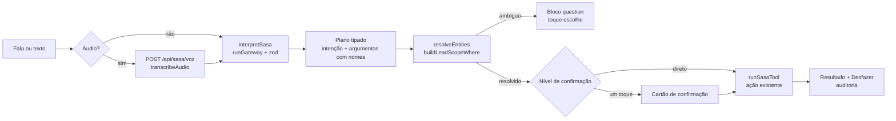

# Sasá agêntica: o corretor fala e ela opera o CRM

Data: 2026-11-19. Estado: **plano, nada implementado**. Branch do plano: `feat/sasa-agentica`.

Objetivo: o corretor do Lite fala ou escreve e a Sasá executa no CRM por ele, sem formulário e sem digitação. Qualquer coisa que hoje pede tela, campo ou toque em sequência pode ser dita numa frase ("marca retorno com a Ana amanhã às 10", "fechou a venda do Carlos", "pausa meu plantão"), inclusive por áudio, de qualquer tela, segurando um botão.

A personagem se chama **Sasá** em todo texto, prompt, código novo e documentação; o nome antigo não volta.

Base desta direção: o registro de venda em conversa (`feat/venda-conversa`, 19/11), em que a IA lê o contrato e só pergunta o que falta. Este plano generaliza esse modelo para o CRM inteiro.

## Feito em 19/11: a conversa da Sasá ficou só agêntica

Pedido do usuário: "o primeiro chat vai ser só para ações agênticas". Branch `feat/sasa-so-agentica`.

- `buildAncoraScript` não recebe mais notificações: só a apresentação da Sasá e as perguntas prontas (dia, quem atender, material das operadoras). Composer: "Peça algo à Sasá".
- A rota `/dashboard/c/ancora` não consulta avisos e não marca mais tudo como lido ao abrir (o `MarkSeenOnView kind="ancora"` saiu).
- A linha da Sasá no Início diz "Peça o que precisar, por texto ou áudio." e não fica mais com ponto azul por aviso.
- Avisos ficam em `/notificacoes` (lista, marcar como lido, push e contagem como antes). Caminho novo: sino no topo do Início do corretor e do supervisor, com a contagem de não lidos (`ChatRailData.unreadNotifications`).
- Supervisor Lite: não escreve para a Sasá; a linha dele vira "Notificações" e abre `/notificacoes`, como no gestor Lite. A rota da Sasá redireciona o supervisor para lá.
- O "Ciente" de recado da Central continua no Mural (`/relacionamento`), aberto pelo próprio aviso.

---

## 1. O que já existe (levantamento no código)

### 1.1 Conversa da Sasá

| Peça | Onde | O que faz hoje |
|---|---|---|
| Identidade | `ASSISTANTS.ancora` em `src/features/broker-workspace/chat/assistant-scripts.ts` | Nome "Sasá", forma `sasa`, rota `/dashboard/c/ancora`, fixa no topo do Início |
| Roteiro | `buildAncoraScript` (mesmo arquivo) | Desde 19/11 só a apresentação e as perguntas prontas (antes trazia os avisos como blocos `notice`); perguntas prontas (`SASA_ASKS`, prefixo `ask:`), perguntas do material das operadoras |
| Rota | `src/app/(dashboard)/dashboard/c/[assistant]/page.tsx` | Só corretor Lite e supervisor Lite; `canWrite` só para corretor; `agentId="ancora"` |
| Tela | `src/components/chat/chat-screen.tsx` + `assistant-chat.tsx` | Renderiza `ChatBlock`, roda `ChatAction` (`href`, `server`, `next`, `local`), envio otimista (`user-send-core.ts`, `clientMessageId` como chave de idempotência) |
| Texto livre | `askAssistantAction` em `src/features/ai-gateway/ask-assistant.ts` | Consentimento LGPD → material da operadora (RAG) → contexto do dia (`workspaceContext`) ou do lead (`leadContext`) → `runGateway` com JSON `{text, suggestions, draftMessage}` → blocos |
| Registro de agentes | `src/features/ai-gateway/agents.ts` | `AGENT_REGISTRY.ancora` (perfil `chat-smart`, `sensitive: true`), `ACTION_CATALOG` com 10 ações que o modelo só **sugere** (o corretor toca) |

Ponto central: hoje a Sasá **responde e sugere**; quem executa é o toque do corretor numa `question`. Ela não preenche argumentos (o retorno sugerido é sempre `when: "tomorrow"`; o lead é sempre o "próximo" da fila ou o da conversa aberta).

### 1.2 Ações de servidor que o chat já dispara

`ChatServerActionName` (`src/components/chat/types.ts`), executadas por `runChatServerAction` (`src/features/broker-workspace/chat/chat-actions.ts`), que só chama ações que o app já tinha, com as mesmas checagens e auditoria:

| Nome | Ação real | Argumentos | Observação |
|---|---|---|---|
| `lead.accept` | `acceptLeadOfferAction` | `leadId` | Devolve link do WhatsApp |
| `lead.decline` | `declineLeadAction` | `leadId`, `reason` | |
| `lead.registerContact` | `startLeadServiceAction` | `leadId` | |
| `lead.changeStep` | `changeLeadStatusAction` | `leadId`, `status` ∈ {`quote_sent`, `negotiation`}, `when?` | Enum curto de propósito |
| `lead.scheduleReturn` | `quickReminderAction` → `criarLembreteDoLead` | `leadId`, `when` ∈ presets, `taskId?` | **`resolverQuandoLembrete` já aceita data ISO**, só o zod do chat limita aos presets |
| `lead.completeReturn` / `cancelReturn` / `reopenReturn` | `setLeadTaskDoneAction` | `taskId` | `cancelReturn` já devolve `undo` |
| `lead.markLost` | `changeLeadStatusAction` (`lost`) | `leadId`, `reason` ∈ `MOTIVOS_PERDA` | |
| `lead.addNote` | `addLeadNoteAction` | `leadId`, `content`, `clientMessageId?` | Idempotente |
| `duty.pause` / `duty.resume` | `updateBrokerAvailabilityAction` | nenhum | |
| `notifications.markRead` | `markAllNotificationsReadAction` | nenhum | |
| `relationship.ack`, `team.addBroker` | | | Fora do escopo do corretor agêntico |

O resultado (`ChatServerActionResult`) já tem `ok`, `message`, `href`, `whatsapp`, `warning` e `undo`. É o contrato certo para a Sasá agêntica: nada de novo no formato de retorno.

### 1.3 Áudio e transcrição

- Transcritor pronto: `src/features/ai-agent/audio-transcription/transcriber.ts` (`resolveTranscriptionTarget`: Groq Whisper turbo, senão OpenAI; `transcribeAudio` com `ai.transcribe`, `language: "pt"`, prompt de domínio, temperatura 0, timeout 30s).
- Regras puras em `rules.ts` (`cleanTranscript`, `estimateTranscriptionCostUsd`, limites de duração/tamanho) e flag por empresa `feature_ai_audio_transcription_<tenantId>` (`flag.ts`).
- Uso atual: áudio **do lead** na qualificação (2026-11-10-ia-qualificacao-audio.md) e na Venda Automatizada (`src/features/auto-sale/audio.ts`), com registro de custo em `logAiUsage`.
- **Não existe gravação no navegador**: nenhum `MediaRecorder` no código. O composer do chat não grava áudio. Tudo do lado do corretor é novo.

### 1.4 Motor de IA

- `src/features/ai/engine.ts`: configuração da IA do sistema (chaves Groq, OpenAI, Google, OpenRouter) via `getSystemSettings`.
- `src/features/ai/vision.ts`: `aiExtractImageText` e `aiExtractPdfText` (leitura do contrato).
- `src/features/ai-gateway/gateway.ts` (`runGateway`): cadeia de provedores por perfil (`chat-fast`, `chat-smart`, `json-structured`, `long-context`, `interpreter`), `sensitive` exclui provedores gratuitos, limite por usuário por minuto (`allow`), cooldown de provedor, `extractJson` + validação zod, `logAiUsage` com provedor e modelo reais, orçamento mensal Anthropic (`anthropic-budget.ts`).
- O gateway hoje **não faz tool calling nativo**: pede JSON e valida com zod. Funciona com todos os provedores da cadeia, inclusive os sem suporte a tools.
- `ai@^7` está instalado (tem `generateText` com `tools`), usado no motor de qualificação.

### 1.5 Registro de venda em conversa (o modelo a seguir)

- `src/features/post-sale/conversation-sale-core.ts`: módulo **puro**. A tela guarda `SaleAnswers`; `saleAwaiting` diz o que falta; `nextSaleBlocks` gera a próxima pergunta em toques; `applySaleText` interpreta texto livre ("3 vidas, 35, 32 e 8"); `mergeContractReading` junta a leitura do contrato e marca `sourced` (o que veio do documento); `reviewBlocks` mostra o resumo e `fixBlocks` deixa corrigir uma parte.
- `src/features/post-sale/components/sale-chat.tsx`: tela sobre `ChatScreen`, serviços injetáveis (`SaleChatServices`: `readContract`, `register`), celebração nível 3 só depois do servidor (`SaleCelebration`, `useFeedback`).
- Rota `/leads/[id]/registrar-venda` com bloqueios explícitos (lead de outro, não aceito, perdido, já registrado).
- No laboratório: fluxo "Registrar venda" com `lab.sale`.

Lição para a Sasá: **slot filling puro + serviços injetáveis + resumo antes de gravar + o que veio da IA marcado**. Cada intenção agêntica deve ter o mesmo formato.

### 1.6 Plantões, agenda, retornos, carteira e etapas

- Dados do dia: `getCachedBrokerWorkspaceData` (`chat-rail-data.ts` → `queries.ts`) traz `viewer` (disponibilidade), `today` (recebidos, aceitos, em atendimento, SLA, retornos, esperando resposta), `duty.active` e `duty.next`, `goal`, `agenda`, `queue` (leads ativos do corretor com `nextAction`), `nextAction`.
- Plantão: `duty-hub.ts`, `duty-now.ts`, `duty-calendar.ts`, presença (`/api/duty/presence`), pausa = disponibilidade (`updateBrokerAvailabilityAction`).
- Agenda e retornos: `agenda-connected.ts`, `lembrete-servico.ts`, `task-actions.ts`.
- Carteira: `src/features/customers/broker-wallet-leads.ts`, rota `/clientes`.
- Prioridade: `priority.ts` (`BrokerWorkspacePriority.kind`: `new_lead`, `sla_risk`, `awaiting_response`, `return_due`, ...).
- Cotação: conversa guiada pura em `quote-flow.ts` (`parseAges`, `nextQuoteBlocks`), cotador real em piloto (2026-11-11-cotador-corretor-catalogo-real.md).
- Escopo de lead: `buildLeadScopeWhere(context)` em `src/features/leads/lead-authorization.ts`; contato só revelado por `canRevealLightContact`.

### 1.7 Feedback, laboratório e superfícies

- `useFeedback()` (`src/lib/feedback/use-feedback.ts`), `ActionNotice` (`src/components/lite/feedback/action-notice.tsx`), `LiteActionButton` (`src/components/lite/controls/action-button.tsx`).
- `FloatingPill` (`src/components/chat/floating-pill.tsx`) e o botão "Agora" flutuante do Início (2026-11-13-agora-flutuante-lite.md) já ocupam o pé da tela: o botão da Sasá precisa conviver com eles.
- `BottomSheet` Arc (`src/components/arc/bottom-sheet/bottom-sheet.tsx`) para a folha curta.
- Laboratório: `src/app/dev/laboratorio/lab.tsx` e `DevLab` em `src/lib/dev-lab.tsx` (serviços simulados por fluxo).
- Service worker em `public/sw.js` só faz cache de estáticos: não há fila offline.

---

## 2. Catálogo de intenções agênticas

Regras de confirmação (valem para todas):

- **Executa direto com "Desfazer"**: ação reversível, de baixo impacto, sobre um alvo resolvido sem dúvida. O resultado aparece em nível 1 e "Desfazer" fica disponível por 8 segundos (e na conversa da Sasá, sem prazo, enquanto a ação inversa ainda fizer sentido).
- **Confirma em um toque**: ação que sai do app (mensagem ao cliente), encerra algo (perder lead, recusar), mexe em dinheiro ou contrato, ou em que a Sasá preencheu argumentos de baixa confiança. Um cartão mostra exatamente o que vai acontecer ("Marcar retorno com Ana Souza, quinta 20/11 às 10:00") com um botão de confirmar e um "Mudar".
- **Só leitura**: responde na hora, sem confirmação.

Escopo de segurança comum: `tenantId`, `userId` e `role` vêm **só** de `getRequiredTenantContext()` no servidor. A IA nunca envia esses campos; ela só devolve nomes e argumentos, e o servidor resolve os ids dentro de `buildLeadScopeWhere` com `corretorId = userId` (corretor) ou o escopo da equipe (supervisor, fase futura). Todo id de lead ou tarefa que volta do cliente é revalidado no escopo antes de executar.

### Prioridade 1 (MVP)

| # | Intenção | Exemplos de fala | Reutiliza | Falta construir | Confirmação |
|---|---|---|---|---|---|
| 1 | Próximo plantão / plantão agora | "qual é meu próximo plantão?", "que horas termina o plantão?" | `duty.active` / `duty.next` de `getCachedBrokerWorkspaceData` | Ferramenta de leitura `duty.next` com resposta curta | Só leitura |
| 2 | Pausar / voltar a receber | "pausa meu plantão", "volta a me mandar lead" | `duty.pause`, `duty.resume` | `undo` em `duty.pause` (devolve `duty.resume`) e vice-versa | Direto com Desfazer |
| 3 | Quem está esperando | "quem está esperando resposta?", "quem eu atendo primeiro?" | `queue` + `nextAction.kind` (`awaiting_response`, `sla_*`, `new_lead`) | Ferramenta `leads.waiting` que devolve bloco `leads` (lista viva já existe como `ChatBlock`) | Só leitura |
| 4 | Agenda do dia | "o que tenho hoje?", "tenho retorno atrasado?" | `agenda` do workspace | Ferramenta `agenda.list` (hoje, amanhã, atrasados) | Só leitura |
| 5 | Marcar retorno em data e hora | "marca retorno com a Ana amanhã às 10" | `lead.scheduleReturn` → `criarLembreteDoLead` (já aceita ISO) | Aceitar `at` ISO no zod do chat; parser de data/hora em pt-BR **no servidor** (puro, testável: "amanhã às 10", "sexta de tarde", "daqui a 2 horas"); resolução de entidade | Direto com Desfazer se lead e hora resolvidos com confiança alta; senão confirma em um toque |
| 6 | Concluir / cancelar / adiar retorno | "já liguei pra Ana", "cancela o retorno do Pedro", "joga o retorno do Pedro pra segunda" | `lead.completeReturn`, `cancelReturn`, `reopenReturn`, `scheduleReturn` com `taskId` | Resolver a tarefa aberta do lead | Direto com Desfazer |
| 7 | Registrar o que o cliente disse | "a Ana disse que vai ver com o marido", "o Carlos pediu pra mandar a cotação da Amil" | `lead.addNote` (idempotente) | Ferramenta que grava a nota com o texto do corretor (resumido pela IA só se ele pedir) e **sugere** a mudança de etapa e o retorno numa pergunta de um toque | Nota: direto com Desfazer (apagar nota precisa de ação nova `lead.removeNote`, só autor e só nos primeiros minutos). Etapa sugerida: um toque |
| 8 | Mudar etapa | "o Carlos está em negociação", "mandei a cotação pra Ana" | `lead.changeStep` (`quote_sent`, `negotiation`) | `undo` com a etapa anterior (`changeLeadStatusAction` com o status anterior, só se nada mais mudou) | Direto com Desfazer |
| 9 | Fechou a venda | "fechou a venda do Carlos", "a Ana assinou" | Rota `/leads/[id]/registrar-venda` (conversa da venda) | Ferramenta `sale.start` que resolve o lead e devolve `href`; com áudio ou texto já trazendo dados ("Amil S380, 1.290, começa dia 1º"), pré-preencher `SaleAnswers` via `applySaleText`/`mergeContractReading` passando um rascunho na URL ou em `sessionStorage` | Abre a conversa da venda (que já tem resumo e confirmação antes de gravar) |

### Prioridade 2

| # | Intenção | Exemplos | Reutiliza | Falta construir | Confirmação |
|---|---|---|---|---|---|
| 10 | Cotação rápida | "cotação para 3 vidas, 35, 32 e 8", "familiar em Niterói, 2 adultos" | `quote-flow.ts` (`parseAges`, `QuoteAnswers`), cotador real em piloto | Ferramenta `quote.start` que preenche `QuoteAnswers` e abre `/cotacao` já no passo que falta (mesmo padrão da venda) | Abre a conversa da cotação. Preço só do simulador, nunca do modelo |
| 11 | Aceitar / recusar lead novo | "aceita o lead", "recusa, ele é de outra cidade" | `lead.accept`, `lead.decline` | Resolver a oferta pendente; mapear motivo para `DECLINE_REASONS` | Aceitar: um toque (o aceite abre o WhatsApp e a oferta tem contador). Recusar: um toque com o motivo |
| 12 | Perder lead | "o Pedro desistiu, achou caro" | `lead.markLost` | Mapear a fala para `MOTIVOS_PERDA` | Um toque (encerra atendimento), com Desfazer depois (reabrir para a etapa anterior) |
| 13 | Rascunho de mensagem ao cliente | "manda pra Ana que a proposta sai amanhã" | `draftMessage` + `buildWhatsAppWebUrl` (já em `replyToBlocks`) | Ferramenta `message.draft` | Nunca envia sozinha: abre o WhatsApp com o texto, o corretor envia (decisão D3) |
| 14 | Dados de um lead | "qual o telefone do Carlos?", "o que a Ana quer?" | `leadContext`, `canRevealLightContact` | Bloco `leadcard` como resposta | Só leitura, contato só se já pode ver |
| 15 | Meta e números | "quanto falta pra meta?", "como estou hoje?" | `goal`, `today` | Bloco `stats` como resposta | Só leitura |
| 16 | Marcar avisos como lidos | "limpa os avisos" | `notifications.markRead` | nada | Direto |

### Prioridade 3 (depois do MVP)

| # | Intenção | Observação |
|---|---|---|
| 17 | Carteira e renovação ("quem renova este mês?") | `broker-wallet-leads.ts`, `customer-renewal-scope.ts`; só leitura |
| 18 | Confirmar presença no plantão por voz | Presencial exige foto: a Sasá abre a câmera. Online: um toque. Nunca confirma sozinha |
| 19 | Pergunta sobre operadora/plano | Já existe (`operatorQuestionReply`, RAG). A Sasá agêntica só encaminha |
| 20 | Atualizar dados do lead ("o Carlos tem 2 filhos, 8 e 5") | Precisa de ação de edição de qualificação com campo a campo e Desfazer |
| 21 | Supervisor ("quem da equipe está pausado?") | Escopo de equipe (`manager-unit-scope.ts`); fase separada |
| 22 | Vários passos numa frase ("anota que ela vai pensar e marca retorno pra sexta") | Plano com 2 ou 3 ações, mostrado como lista e confirmado em um toque |

Fora de escopo, por decisão de segurança: excluir lead, transferir lead entre corretores, mexer em comissão, alterar configuração, enviar mensagem ao cliente sem o corretor apertar enviar.

---

## 3. Arquitetura



### 3.1 Roteamento de intenção (tool calling sobre ações tipadas)

- **Registro único de ferramentas** `src/features/sasa/tools.ts`: cada ferramenta tem `name`, descrição para o modelo, `args` (zod, com nomes e datas como texto, nunca ids), `confirm: "none" | "undo" | "tap"`, `kind: "read" | "write" | "open"`, e `run(context, resolvedArgs)` que chama **a ação já existente** (`runChatServerAction` ou leitura do workspace). O registro é a única coisa que o modelo enxerga; SQL livre, nome de tabela ou id não entram no prompt.
- **Saída do modelo**: um objeto validado por zod, união discriminada por `tool`:
  `{ tool: "returns.schedule", args: { lead: "Ana", when: "amanhã às 10" }, say: "..." }` ou `{ tool: "none", say: "..." }` ou, na fase 4, `{ steps: [...] }`.
  **Recomendado**: manter o `runGateway` (JSON + zod) em vez de tool calling nativo. Motivos: já tem cadeia de provedores, `sensitive`, limite por minuto, orçamento e `logAiUsage`; funciona com qualquer provedor; o formato é o mesmo de "tool calling" do ponto de vista de segurança (o modelo escolhe uma ferramenta tipada e argumentos validados). Tool calling nativo do `ai@7` fica para quando houver encadeamento de várias leituras (fase 5), atrás da mesma interface.
- **Atalho sem IA**: antes do modelo, um classificador por regras puras pega as frases mais comuns ("pausa", "volta a receber", "próximo plantão", "quem está esperando"). Reduz custo e funciona quando a IA está fora.
- **Contexto mínimo**: o prompt recebe a lista de ferramentas, a data/hora local, o primeiro nome do corretor e só os **primeiros nomes** dos leads ativos (para ajudar o modelo a separar nome de verbo). Nada de telefone, CPF ou mensagem do cliente para interpretar a intenção.
- **Datas**: o modelo devolve o texto da data ("amanhã às 10"); um parser puro no servidor (`parseWhenPtBr`, fuso `America/Sao_Paulo`) converte para ISO. Se o parser não entender, a Sasá pergunta com opções em toque (hoje 18h, amanhã 9h, escolher). O modelo nunca calcula data.
- **Onde roda**: nova Server Action `sasaCommandAction({ text, clientCommandId, origin })` em `src/features/sasa/command-action.ts`. `askAssistantAction` continua para perguntas abertas; o roteador decide: ferramenta encontrada → executa; `tool: "none"` → cai no fluxo atual de resposta.

### 3.2 Transcrição de áudio

- Gravação no navegador: `MediaRecorder` com `audio/webm;codecs=opus` (Android/desktop) ou `audio/mp4` (iPhone). Teto de 60 segundos, mostrado no botão.
- Envio: `POST /api/sasa/voz` (rota, não Server Action, por causa do corpo binário), `multipart` com o áudio e `clientCommandId`. Limite de 2 MB.
- Servidor: tenant e usuário da sessão; consentimento de IA; reaproveita `resolveTranscriptionTarget` + `transcribeAudio` com um prompt de domínio do corretor (nomes de operadora, "retorno", "plantão", "cotação", "vidas"). `cleanTranscript` e `estimateTranscriptionCostUsd` de `rules.ts`.
- **O áudio não é guardado**: transcreve em memória e descarta. Só o texto vai para o comando (e para a auditoria).
- A transcrição aparece na tela antes do resultado ("Você disse: marca retorno com a Ana amanhã às 10"), com "Corrigir" que abre o texto para editar. Assim um erro do Whisper nunca vira ação silenciosa.
- Flag própria por empresa (`feature_sasa_voice`), independente da flag de áudio do lead.

### 3.3 Resolução de entidades ("o Carlos" → qual lead)

- `resolveLead(context, name)` puro sobre uma consulta já escopada (`buildLeadScopeWhere` + `corretorId = userId`, sem `deletedAt`, sem placeholder "Lead WhatsApp"): normaliza acento e caixa, compara primeiro nome, nome completo e apelido; ordena por recência de interação e por ter `nextAction`.
- Resultados:
  - um candidato forte → segue;
  - 2 a 4 candidatos → bloco `question` com cada lead (nome completo, etapa, última interação) e um toque escolhe; o comando continua com o escolhido sem repetir a fala;
  - nenhum → "Não achei Carlos entre os seus leads" com "Ver meus leads".
- Leads de outro corretor ou de outro tenant **não aparecem** nem como "não pode": a consulta já não os enxerga.
- Contexto da tela: se o botão foi apertado dentro da ficha ou da conversa de um lead, "ele/ela" e frases sem nome usam esse lead (passado como `leadId` e revalidado no escopo).
- Tarefas: `resolveReturn(lead)` pega o retorno aberto mais próximo; se houver mais de um, pergunta em toque.

### 3.4 Auditoria

- Toda ação de escrita já grava auditoria pela ação existente (status, nota, tarefa). A Sasá acrescenta a **origem**: nova tabela `sasa_commands` (migration com o próximo número livre entre as branches, ver memória de colisão) com `id`, `tenantId`, `userId`, `clientCommandId` (único: idempotência), `origin` (`voice` | `text` | `tap`), `transcript` (texto, sem áudio), `tool`, `args` resolvidos (ids), `confirmation` (`none` | `undo` | `tap`), `status` (`done` | `undone` | `failed` | `cancelled` | `ambiguous`), `resultMessage`, `undoOf`, `aiUsageId`, `createdAt`.
- As ações existentes recebem `via: "sasa"` quando chamadas pela Sasá, para o histórico do lead mostrar "Pela Sasá".
- Retenção: transcrições apagadas (texto zerado) após 90 dias; o resto fica como trilha (D5).

### 3.5 Limites, custos e LGPD

- Consentimento: o mesmo `readAiConsent` (`AI_CONSENT_SCOPE = "broker_assistants"`). Sem consentimento, o botão mostra o cartão `consent` na primeira vez e não grava áudio. O texto do termo ganha uma linha sobre voz (nova versão de `AI_CONSENT_VERSION`, ver D6).
- `sensitive: true` no agente roteador: nenhum provedor gratuito vê comando com nome de cliente.
- Limites: o `allow` do gateway (por minuto) mais um teto diário por corretor (sugestão: 150 comandos e 20 minutos de áudio por dia) usando `countAiCallsToday`. Orçamento mensal já existe (`anthropic-budget.ts`).
- Custo estimado por comando: transcrição Groq turbo de 5 a 10 segundos (frações de centavo) + uma chamada `chat-fast` de ~800 tokens. O atalho por regras zera o custo das frases mais comuns.
- Minimização: o modelo de interpretação só recebe primeiros nomes; telefone, CPF e mensagens do cliente nunca entram nessa chamada. A leitura de um lead (intenção 14) usa o `leadContext` atual, que já mascara (`maskPersonalData`).

### 3.6 Internet ruim

- O botão grava sempre, mesmo sem rede. Sem conexão, o áudio fica em `IndexedDB` (fila local, no máximo 5 comandos, 24h) com estado "Vou enviar quando a internet voltar"; nada é executado de forma otimista no servidor.
- Reenvio automático com o mesmo `clientCommandId` (idempotente em `sasa_commands`): se o primeiro envio chegou e a resposta se perdeu, o servidor devolve o resultado guardado em vez de executar de novo.
- Comandos que dependem de hora ("marca retorno daqui a 1 hora") usam a hora da **gravação** (`recordedAt` enviado junto), não a do envio.
- Comando que chega mais de 30 minutos depois e é de escrita vira **confirmação em um toque** em vez de direto ("Gravado às 14:02: marcar retorno com a Ana amanhã às 10. Confirmar?").
- Timeouts curtos (transcrição 15s, interpretação 8s) e erro com causa: "Não consegui entender o áudio. Seu comando continua aqui." + "Tentar de novo" e "Escrever".

---

## 4. Botão flutuante "segurar e falar"

### 4.1 Comportamento

- **Onde aparece**: todas as telas do corretor Lite (`isLightBroker` no `src/app/(dashboard)/layout.tsx`), montado uma vez no shell (`<SasaVoiceButton />`), atrás de flag por empresa.
- **Onde não aparece**: dentro de qualquer conversa (Sasá, lead, venda, cotação: elas têm o próprio composer), com folha (`BottomSheet`) ou diálogo aberto, durante celebração (`CelebrationLayer`, `AchievementHost`), durante a oferta de lead com contador, com o teclado aberto, e na câmera. Implementação: um contexto `SasaVoiceVisibility` que as superfícies registram ao abrir (mesmo padrão do anfitrião de conquistas, que espera a oferta e os diálogos).
- **Gesto**:
  - segurar (a partir de 200 ms, para não confundir com toque) → começa a gravar;
  - soltar → envia;
  - arrastar para o lado (mais de 64 px, esquerda) → cancela, sem enviar;
  - toque curto → abre a conversa da Sasá com o teclado (alternativa sem voz e acessível);
  - teclado: `Espaço`/`Enter` pressionado segura; `Esc` cancela. Leitor de tela: botão "Falar com a Sasá", com "Gravando, solte para enviar, deslize para cancelar".
- **Posição**: canto inferior direito, acima da navegação do Lite e da área segura; 56 px de área de toque. No Início, quando o botão "Agora" flutuante (centralizado) estiver visível, os dois não se sobrepõem (D7).

### 4.2 Estados

| Estado | Visual | Texto | Feedback (`FEEDBACK.md`) |
|---|---|---|---|
| Repouso | círculo com a Sasá pequena, borda 1px, sem sombra pesada | rótulo acessível | nível 0 |
| Pressionado | `scale.press` | | vibração `tap` via `useFeedback` (nível 1, ação ocasional) |
| Gravando | anel do nível de voz (amplitude), tempo "0:04", seta "deslize para cancelar" | "Ouvindo…" | sem som; anel parado com `prefers-reduced-motion` (só o tempo muda) |
| Cancelado | volta ao repouso | "Cancelado" por 1s | nível 0 |
| Enviando | spinner no lugar do ícone, `aria-busy` | "Entendendo…" | nível 0 |
| Pedindo escolha | folha curta com a pergunta em toques | a pergunta | nível 0 |
| Feito | toast com ação: check desenhado + texto que nomeia o resultado + "Desfazer" | "Retorno com Ana amanhã às 10:00" | nível 1: `confirm` só depois do servidor; sem som de celebração. Fechou venda → a celebração é da própria conversa da venda, não do botão |
| Falhou | toast de erro com causa, o que continua valendo e "Tentar de novo" | "Não consegui marcar. Nada foi alterado." | `error` via `useFeedback` |

Ritmo: visual na hora, texto +80 ms, número +160 ms. Nenhum confete, nenhum nível 2 ou 3 a partir do botão. Kill-switch e interruptores do usuário (som, vibração, animações) respeitados pelo próprio `useFeedback`.

### 4.3 Onde a resposta aparece

- **Toast com ação** (padrão, para nível 1 e só leitura curta): uma linha de resultado + um botão ("Desfazer", "Abrir", "Ver lista"). Some em 6s; com leitor de tela, `role="status"`.
- **Folha curta** (`BottomSheet`, um detent baixo): quando a resposta é uma lista (quem está esperando, agenda), uma escolha (qual Carlos?) ou uma confirmação de um toque. A folha usa os mesmos `ChatBlock` (`leads`, `question`, `facts`) renderizados pelos componentes do chat, sem recriar UI.
- **Navegação**: intenções `open` (venda, cotação) vão direto para a conversa certa, já pré-preenchida.
- Tudo o que a Sasá fez pelo botão também entra na conversa da Sasá (histórico: "Você disse… · Fiz…"), para o corretor achar depois e desfazer.

### 4.4 Design system

- Superfícies e cores do Lite (`LITE_CHAT_DESIGN_SYSTEM.md` §5.8 para flutuantes, tokens `--chat-action`), borda 1px, sem sombra pesada, raio total no botão, 12px na folha.
- Não é CTA primário: o botão é secundário e convive com a CTA da tela (regra de uma CTA por tela). Por isso não usa a base sólida do `LiteActionButton` (D7).
- Microfone e estados ilustrados com a Sasá existente (`AssistantAvatar` forma `sasa`), sem asset novo no MVP.

---

## 5. MVP em fases

Cada fase entra no laboratório (`/dev/laboratorio`) como um fluxo novo, com as telas reais e o servidor simulado por `useDevLab`. Contrato novo em `DevLab`:

```ts
sasa?: {
  transcribe: (audio: Blob) => Promise<{ ok: true; text: string } | { ok: false; error: string }>;
  command: (input: { text: string; clientCommandId: string; leadId?: string }) => Promise<SasaCommandResult>;
  undo: (commandId: string) => Promise<{ ok: boolean; message: string }>;
};
```

No painel do laboratório: resposta do servidor (ok, falha, ambíguo, sem rede), demora (rápido, normal, lento) e "Recomeçar", como nos outros fluxos. Frases de exemplo prontas para tocar, para testar sem microfone.

### Fase 0 · Fundação pura (sem UI nova)

- `src/features/sasa/tools.ts` (registro tipado), `intent-rules.ts` (atalho por regras), `parse-when.ts` (datas pt-BR), `resolve-entities.ts` (nomes → leads, puro sobre uma lista).
- Testes unitários com as frases do catálogo (incluindo erros de transcrição comuns: "Ana Paula" vs "Ana", "amanhã as dez").
- Laboratório: nenhum fluxo ainda; os testes são a prova.

### Fase 1 · Sasá executa por texto, só leitura e ações reversíveis

- `sasaCommandAction` + intenções 1 a 6 e 8 (plantão, pausa, esperando, agenda, retorno com data e hora, concluir/cancelar retorno, etapa).
- `undo` nas ações que ainda não têm (`duty.pause`/`resume`, `lead.changeStep`).
- Tabela `sasa_commands`, idempotência, `via: "sasa"`.
- Entra na conversa da Sasá: o texto livre passa primeiro pelo roteador.
- Laboratório: fluxo "Sasá por texto" com a conversa real da Sasá e o servidor simulado; casos ok, ambíguo ("Carlos" com 2 leads), falha e Desfazer.

**Entregue em 19/11 (branch `feat/sasa-fase-1`).** Fases 0 e 1 juntas:

- Núcleo puro em `src/features/sasa/`: `parse-when.ts` (datas em pt-BR, fuso de São Paulo), `intent-rules.ts` (atalho por regras), `resolve-entities.ts` (nome → lead, só entre os leads do corretor), `command-core.ts` (`runSasaCommand`: planeja, executa pela ação existente, devolve Desfazer ou Tentar de novo). Testes em `sasa.test.ts`.
- `sasaCommandAction` (`command-action.ts`): só corretor, liberação do piloto (`brokerAiAccess`), regras primeiro; a IA (`interpret.ts`, JSON + zod no `runGateway`, `sensitive`, só primeiros nomes) só entra com consentimento e quando as regras não casam. O que não é pedido volta para `askAssistantAction`.
- Ações do chat: `lead.scheduleReturn` aceita `at` (hora exata) e devolve Desfazer (`lead.undoReturn`, que reabre o retorno substituído); `lead.changeStep` aceita `documentation_pending` e a etapa anterior (Desfazer por `lead.restoreStep`); `lead.completeReturn`, `duty.pause` e `duty.resume` ganharam Desfazer.
- Feedback de nível 1 via `feedbackOnResult` (toque, confirmação depois do servidor, erro), sem som de celebração.
- Laboratório: fluxo "Sasá: pedidos por texto" com o núcleo real sobre um corretor de mentira (dois Carlos, retorno atrasado, gente esperando) e pedidos prontos para tocar.
- **Desvio do plano**: a auditoria usa `audit_logs` (`entidade = "sasa_command"`, `entidadeId = clientCommandId`, metadados com tenant, texto, ferramenta e resposta) em vez da tabela nova `sasa_commands`. Dá a mesma trilha e a idempotência sem migration; a tabela própria entra quando houver transcrição (fase 2).
- **Pendente**: limpeza das transcrições após 90 dias (D5) e teto diário de 150 comandos (D9) entram com a voz (fase 2), que é quando passam a existir transcrição e custo por comando; hoje as regras não custam e a IA já tem o limite por minuto do gateway.

### Fase 2 · Voz na conversa da Sasá

- Microfone no composer da conversa da Sasá (segurar para falar ali dentro), `POST /api/sasa/voz`, transcrição exibida com "Corrigir".
- Laboratório: fluxo "Sasá por voz" com `transcribe` simulado (texto fixo por cenário) e opção de usar o microfone de verdade só no navegador.

**Entregue em 19/11 (branch `feat/sasa-fase-2`).**

- Microfone no composer da conversa da Sasá (`composer.tsx` + `voice-recorder.ts`): com o campo vazio, o botão de enviar vira microfone. Segurar grava (até 60 s), soltar envia, arrastar 64 px para a esquerda cancela, toque rápido explica "Segure o microfone enquanto fala". Teclado: Espaço ou Enter seguram, Esc cancela. Estados gravando (ponto, tempo, dica), "Entendendo o áudio…" e erro com a causa; vibração de toque e de erro via `useFeedback`, sem som; ponto e giro parados com `prefers-reduced-motion`.
- `POST /api/sasa/voz`: sessão, só corretor do piloto (D8), consentimento de IA, até 2 MB; transcreve com o transcritor existente (Groq ou OpenAI) e um vocabulário da Sasá, em memória, e descarta o áudio (D4). Só o texto vai para `sasa_commands`, ligado ao pedido pelo mesmo `clientCommandId`; reenvio devolve o texto sem cobrar de novo.
- "Corrigir o que eu ouvi": toda resposta a um pedido por voz traz essa opção. Ela desfaz o que foi feito com o texto errado (pelo mesmo Desfazer) e devolve o texto ao campo para corrigir e enviar.
- Tabela própria `sasa_commands` (migration `drizzle/0233_sasa_commands.sql`): um registro por pedido, único por corretor e `client_command_id`; substitui a auditoria em `audit_logs` da fase 1. Sem a tabela, a Sasá continua funcionando, só sem histórico e teto.
- Teto (D9): 150 pedidos e 20 minutos de áudio por dia de São Paulo (`limits.ts`), conferidos antes de transcrever e antes de executar.
- Limpeza (D5): `/api/internal/jobs/sasa-cleanup`, `30 6 * * *` (03:30 em SP), apaga transcrição e resposta com mais de 90 dias; documentada no runbook do Coolify e no espelho `job-schedule.ts`.
- Laboratório: o fluxo "Sasá: pedidos por texto e voz" grava de mentira (o painel não tem microfone), com o mesmo gesto e estados; a transcrição simulada traz, em ordem, um pedido certo, um com a hora errada (para testar o Corrigir), pausar e quem está esperando.
- **Antes do deploy**: aplicar `drizzle/0233_sasa_commands.sql` e criar a Scheduled Task `sasa-cleanup` no Coolify. A voz usa as chaves de transcrição que a qualificação por áudio já usa (Groq ou OpenAI).

### Fase 3 · Botão flutuante em todo o Lite

- `SasaVoiceButton` no shell, contexto de visibilidade, toast com ação e folha curta.
- Fila offline em IndexedDB e regra dos 30 minutos.
- Laboratório: fluxo "Botão da Sasá" sobre o Início real e sobre a lista de leads, com chave "Sem internet" no painel; verifica onde ele some (oferta de lead, folha aberta, celebração).

### Fase 4 · Venda, cotação e registrar o que o cliente disse

- Intenções 7, 9, 10 (nota + sugestão de etapa e retorno; "fechou a venda do Carlos" abrindo a conversa da venda já pré-preenchida; cotação com idades).
- Laboratório: "Fechou a venda" começa no botão e cai no fluxo "Registrar venda" já existente, com respostas pré-preenchidas.

### Fase 5 · Sensíveis e vários passos

- Intenções 11 a 13 (aceitar/recusar, perder, rascunho de mensagem), 22 (vários passos numa frase, lista confirmada em um toque), e avaliação de tool calling nativo para leituras encadeadas.
- Laboratório: casos de confirmação em um toque e de plano com 2 passos.

Critério de pronto de cada fase: testes puros verdes, fluxo no laboratório cobrindo ok/falha/ambíguo/lento, checklist do `FEEDBACK.md` §10, revisão visual do usuário antes do merge.

---

## 6. Riscos

- **Transcrição errada vira ação errada**: mitigado por mostrar o que foi entendido, Desfazer em tudo que executa direto, e confirmação quando a confiança for baixa.
- **Nome ambíguo**: desambiguação por toque; nunca escolhe sozinha entre dois leads com o mesmo primeiro nome.
- **Custo**: atalho por regras, `chat-fast`, teto diário e orçamento existente.
- **Concorrência com o botão "Agora"** e outras flutuantes: contexto de visibilidade único.
- **iPhone**: `MediaRecorder` só grava `audio/mp4`; Whisper aceita. Vibração ignorada pelo iOS (já previsto no `FEEDBACK.md`).

---

## 7. Decisões (aprovadas em 19/11)

O usuário aprovou as 10 opções recomendadas ("pode seguir com as decisões recomendadas do plano da Sasá"). Valem como decididas:

1. D1: interpretação por JSON + zod no `runGateway`.
2. D2: ações reversíveis executam direto, com Desfazer.
3. D3: mensagem ao cliente, sempre o corretor envia.
4. D4: áudio do corretor descartado depois de transcrito.
5. D5: transcrição guardada por 90 dias.
6. D6: nova versão do termo de IA citando voz.
7. D7: botão no canto inferior direito, secundário, sem base sólida.
8. D8: piloto por corretor antes da empresa inteira.
9. D9: teto de 150 comandos e 20 min de áudio por dia.
10. D10: supervisor Lite numa fase separada.

Tabela original, para referência:

| # | Decisão | Opções | Recomendado |
|---|---|---|---|
| D1 | Interpretação | JSON + zod pelo `runGateway` / tool calling nativo do `ai@7` | **JSON + zod pelo gateway** (mesma segurança, todos os provedores, custo e limite já prontos) |
| D2 | Ações que executam direto | só leitura / reversíveis com Desfazer / tudo com confirmação | **Reversíveis com Desfazer** (retorno, etapa, nota, pausa) |
| D3 | Mensagem ao cliente | a Sasá envia sozinha / sempre o corretor envia | **Sempre o corretor envia** (ela abre o WhatsApp com o texto) |
| D4 | Áudio do corretor | descartar após transcrever / guardar 30 dias | **Descartar** (só o texto fica) |
| D5 | Retenção da transcrição em `sasa_commands` | 30 / 90 / 365 dias | **90 dias** |
| D6 | Consentimento | reaproveitar o atual / nova versão do termo citando voz | **Nova versão citando voz** (pede de novo uma vez) |
| D7 | Posição do botão | canto inferior direito / centro / dentro da navegação | **Canto inferior direito**, secundário, sem base sólida |
| D8 | Quem testa primeiro | piloto por corretor (`broker_ai_pilot_user_ids`) / empresa inteira | **Piloto por corretor**, depois flag por empresa |
| D9 | Teto diário por corretor | 50 / 150 / sem teto | **150 comandos e 20 min de áudio** |
| D10 | Supervisor Lite | junto / fase separada | **Fase separada** (escopo de equipe pede regras próprias) |
